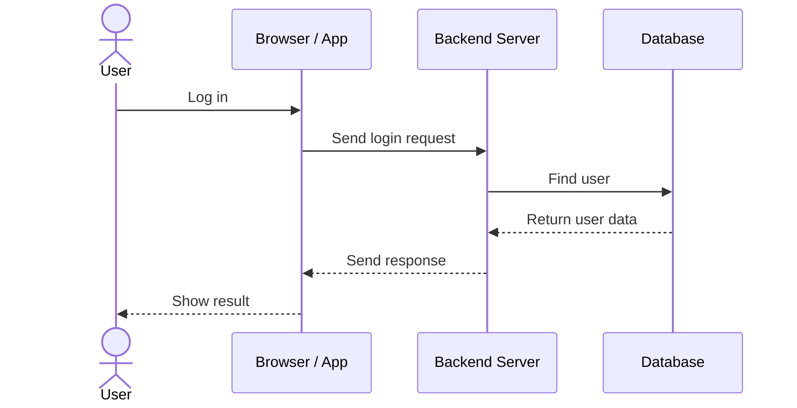

# Client-Server Architecture

## 1. What Is Client-Server Architecture?

Client-server architecture is a way to build an application where the **client asks for something** and the **server handles the request and sends back a response**.

Example: When you open a website, your browser asks the server for the page. The server sends back the data needed to display it.

## 2. Client vs Server

| Part | What it does | Example |
|---|---|---|
| **Client** | Sends requests and shows the result to the user | Browser, mobile app |
| **Server** | Receives requests, runs application logic, and sends responses | Node.js/Express backend |
| **Database** | Stores data that the server needs | PostgreSQL, MongoDB |

The database is usually accessed by the server, not directly by the client. This helps protect private data and database credentials.

## 3. How Does It Work?

1. The user performs an action, such as logging in.
2. The client sends a request to the server.
3. The server checks the request and runs the required logic.
4. If needed, the server reads or saves data in the database.
5. The server sends a response to the client.
6. The client displays the result to the user.

## 4. Request Flow Diagram

This UML-style sequence diagram shows the order of messages between the main parts.

## 5. Real-World Example

In a task management app, when you create a task:

- The client sends the task title to the server.
- The server checks the data.
- The server saves the task in the database.
- The server returns a success response.
- The client shows the new task on the screen.

## 6. Why Use This Architecture?

- **Separation of work:** The client handles the user interface; the server handles business logic.
- **Security:** Important rules and database credentials stay on the server.
- **Shared access:** Different clients, such as a website and mobile app, can use the same backend.
- **Easier maintenance:** Client and server parts can often be changed separately.

## 7. Important Things to Remember

- The client and server usually communicate over a network using HTTP or HTTPS.
- A request can fail if the network or server is unavailable, so the client should handle errors.
- More users may require a stronger server or multiple servers.
- A client-server application does not automatically need microservices. A single backend can be enough at the beginning.

## 8. Quick Revision

- **Client:** Sends requests and displays results.
- **Server:** Processes requests and sends responses.
- **Database:** Stores application data.
- **Request:** A message asking the server to do something.
- **Response:** The server's reply to a request.

**Remember:** The client asks, the server processes, and the database stores or returns data when needed.

## Related Notes

- [System Design Basics](./system-design-basics.md)
- [Networking](./networking.md)
- [API Design](./api-design.md)
- [Databases](./databases.md)
