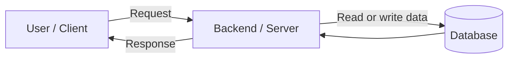

# System Design Basics

## 1. What Is System Design?

**System design is planning how the parts of a software application work together.** It helps us decide what the app needs, how requests move through it, where data is stored, and how it can stay fast, safe, and reliable as it grows.

Think of it like planning a house before building it. First, we decide what is needed and how the parts connect.

## 2. Why Do We Need It?

A good system should be:

- **Useful:** It solves the user's problem.
- **Fast:** It responds in a reasonable time.
- **Reliable:** It works correctly most of the time.
- **Scalable:** It can handle more users or work when needed.
- **Secure:** It protects accounts and data.
- **Maintainable:** Developers can fix and improve it easily.
- **Cost-effective:** It does not waste money on unnecessary resources.

System design balances two perspectives:

- **User perspective:** The app should be easy to use, fast, and safe.
- **Business perspective:** The app should solve the right problem, stay within budget, and support business growth.

For example, adding more servers may make an app faster during busy times, but it also increases costs. A good design considers both.

## 3. Understand the Requirements First

Before choosing technologies or drawing diagrams, understand what the system needs to do.

### Functional requirements

These describe **what the system should do**.

For a task management app:
- Users can create tasks.
- Users can view their tasks.
- Users can update task status.
- Users can delete tasks.

### Non-functional requirements

These describe **how well the system should work**.

Examples:
- **Performance:** How quickly should it respond?
- **Scalability:** Can it handle more users?
- **Availability:** Can users access it when they need it?
- **Security:** How will accounts and data be protected?
- **Reliability:** Will it work correctly and recover from failures?
- **Maintainability:** Can developers safely change it?

In an interview, clarify which requirements are most important. You cannot improve everything equally at the same time.

## 4. High-Level Design (HLD) vs Low-Level Design (LLD)

### High-Level Design (HLD)

HLD shows the **main parts of the system and how they connect**. It covers the overall architecture, data flow, communication, and major technology choices.

**Example:** For a food delivery app, HLD may show the user, order, payment, delivery, and notification services and how an order moves between them.

### Low-Level Design (LLD)

LLD explains **how one part is built internally**. It may include classes, methods, data fields, and the relationships between them.

**Example:** For an order component, LLD may define an `Order` with an order ID, user ID, and items, plus methods to create or cancel an order.

**Remember:** HLD is about the overall system. LLD is about the internal details of a part.

## 5. The Basic Parts of a Web Application

A simple web application usually has three main parts:

1. **Client:** The browser or mobile app that sends requests and shows results.
2. **Backend/server:** Receives requests, checks them, applies application rules, and returns responses.
3. **Database:** Stores information so it can be used later.

**Example:** When a user creates a task, the client sends its details to the backend. The backend checks the request, saves the task in the database, and returns a response.

Real systems may also use a cache, load balancer, message queue, or file storage. Add them when there is a clear reason, not just because they are popular.

## 6. What Should We Consider When Designing a System?

Keep these questions in mind when planning a system:

- **Scalability:** Can it handle more users during busy times and reduce resources when traffic drops?
- **Performance:** How long do requests take? Slow responses can make users leave.
- **Communication:** How do the system's parts pass information to each other?
- **Data management:** What data do we store, which database fits it, and how will the app access it? A cache may help when the same data is read often.
- **Reliability and fault tolerance:** What happens if a server fails? Can another server take over, or can the system recover?
- **Security and privacy:** Who can access the data? How do we protect it and follow the rules that apply to the app?
- **Monitoring:** How will the team know when something is slow or broken?
- **Maintainability and cost:** Can developers support the system easily without paying for more resources than needed?

You do not need a complex solution for every point. Think about what the application actually needs.

## 7. Important Terms

| Term | Simple meaning |
|---|---|
| **Latency** | How long one request takes to get a response. |
| **Throughput** | How much work the system handles in a period of time. |
| **Scalability** | The ability to handle more work as demand grows. |
| **Availability** | How often the system is accessible. |
| **Reliability** | How consistently the system works correctly. |
| **Fault tolerance** | The ability to keep working or recover when part of the system fails. |
| **Bottleneck** | The part that limits the performance of the whole system. |
| **Trade-off** | A choice where improving one thing may make another thing worse. |

These terms are related but not the same. For example, an application may respond quickly but still fail often.

## 8. How Can a System Handle More Users?

There are two common ways to add computing capacity:

- **Vertical scaling:** Give one server more resources, such as CPU or memory. It is simple, but the server has limits.
- **Horizontal scaling:** Add more servers and share the work between them. It can support more growth, but it also adds complexity.

Start with the simplest design that meets the requirements. Add more components when there is a real need.

## 9. A Simple System Design Interview Approach

When asked to design an application, follow this order:

1. **Understand the problem:** Who will use it, and what do they need?
2. **List requirements:** Separate functional and non-functional requirements.
3. **Choose the scope:** Decide what the first version must support.
4. **Estimate the load if needed:** Consider users, requests, and data size if they affect your design.
5. **Plan APIs and data:** Decide how the client talks to the backend and what data must be stored.
6. **Draw the HLD:** Show the main components and how they connect.
7. **Explain the flow:** Walk through what happens when a user performs an action.
8. **Check problems and trade-offs:** Consider failures, security, bottlenecks, future growth, and cost.

Explain why you chose each component. Do not add every possible tool just to make the design look advanced.

## 10. Common Beginner Mistakes

- Choosing technologies before understanding the requirements.
- Adding a cache, load balancer, or microservices without a clear reason.
- Ignoring failures and security.
- Naming components without explaining what they do.
- Making the design complicated before it is needed.

**Remember:** The best design is not the most complicated one. It is the simplest design that meets the requirements and can grow when needed.

## 11. Quick Revision

- System design plans how an application's parts work together.
- Functional requirements describe **what** it does; non-functional requirements describe **how well** it works.
- HLD shows the overall system; LLD shows the internal details of a component.
- A basic web application has a client, backend, and database.
- Latency is response time; throughput is the amount of work handled over time.
- Vertical scaling makes one server bigger; horizontal scaling adds servers.
- Always balance user experience, business needs, reliability, security, and cost.

## Related Notes

- [Networking](./networking.md)
- [API Design](./api-design.md)
- [Databases](./databases.md)
- [System Design Problems](../04-system-design-problems/)
