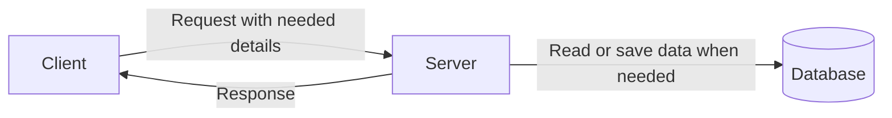

# Stateless vs Stateful

## 1. What Is the Difference?

**Stateless** means the server does not keep a user's session information between requests. Each request carries the information the server needs, or the server gets it from shared storage.

**Stateful** means the server keeps information about a user's session or previous activity and uses it for later requests.

### Simple example

Think of a help desk:

- **Stateless:** Every time you ask for help, you provide your ticket number again.
- **Stateful:** The staff member remembers your case and continues from where you stopped.

## 2. How Does It Work?

### Stateless flow

The client sends the needed details with each request. The server handles the request and sends a response without relying on memory of an earlier request.

For example, a server can validate a login token sent with each request. The user's profile and other saved data can still live in a database.

### Stateful flow

The server keeps session information, such as whether a user is logged in. Later requests may depend on that session information.

## 3. Main Differences

| Stateless | Stateful |
|---|---|
| The server does not remember the session between requests. | The server keeps session information between requests. |
| Requests carry the needed details or use shared storage. | Requests may rely on the saved session. |
| Easier to send requests to different servers. | Requests may need access to the same session or shared session storage. |
| Common in REST APIs using tokens. | Common in applications that keep server-side sessions or ongoing connections. |

## 4. Why Does This Matter in System Design?

Imagine an application running on three backend servers behind a load balancer.

- With **stateless servers**, any server can usually handle the next request, as long as it can access the required data and authentication information.
- With **stateful servers**, the next request may need the server holding the user's session, or the session must be shared between servers.

Stateless design can make scaling easier, but it does not automatically make an application faster or more reliable. The database and other shared services still need to be designed properly.

## 5. When Should We Use Each?

- **Stateless:** A common choice for REST APIs and backend services that need to scale across multiple servers.
- **Stateful:** Useful when the server needs to maintain ongoing session or connection information, such as a live WebSocket connection.

Both approaches can be used in the same application. For example, most API requests may be stateless while a chat connection is stateful.

## 6. Quick Revision

- **Stateless:** The server does not keep session memory between requests.
- **Stateful:** The server keeps session or connection information for later use.
- Stateless servers are generally easier to scale horizontally.
- A stateless server can still read and write data in a database.
- Stateful systems can scale too, but session sharing and routing need consideration.

### Still not understanding Watch this: [ Stateless vs Stateful Communication | Explained with Real-Life Examples | Hindi-English](https://youtu.be/wHv9HmZeQsY)

## Related Notes

- [Client-Server Architecture](../01-fundamentals/client-server.md)
- [API Design](../01-fundamentals/api-design.md)
- [Load Balancer](../02-components/load-balancer.md)
- [Scalability](./scalability.md)
- [Redis](../02-components/redis.md)
