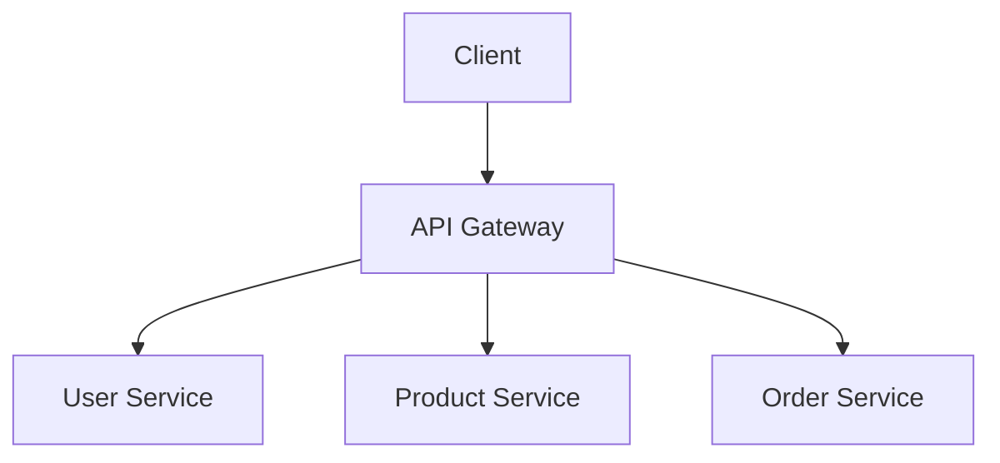

# API Gateway Pattern

## What is an API Gateway?

An API Gateway is a single entry point that receives requests from clients and sends each request to the correct backend service.

Instead of making the client contact many services directly, it can send requests through the gateway.

## Why do we need it?

Imagine a shopping app with separate services for users, products, and orders.

Without a gateway, the client may need to know the address of each service. With an API Gateway, the client sends requests to one entry point, and the gateway routes them to the right service.

## How does it work?

1. The client sends a request to the API Gateway.
2. The gateway checks the request and decides which service should handle it.
3. The gateway forwards the request to that service.
4. The service processes the request and returns a response through the gateway.

## Simple example

A customer opens a shopping app.

- To view products, the app sends a request through the gateway to the Product Service.
- To see their orders, the app sends a request through the gateway to the Order Service.
- The app uses the same entry point for both requests.

The client does not need to manage a separate public address for every service.

## What can an API Gateway do?

Depending on the system, it may:

- Route requests to the correct service.
- Check authentication.
- Apply rate limits.
- Record request logs.
- Combine responses from multiple services when needed.

These features depend on the gateway and its configuration. Keep business rules in the appropriate backend services.

## When should we use it?

An API Gateway is useful when an application has multiple backend services and needs one managed entry point for client requests.

For a small application with one backend service, adding a gateway may create unnecessary complexity.

## API Gateway vs. Load Balancer

- **API Gateway:** Understands API requests and can route them by path or other request details. It may also handle authentication and rate limiting.
- **Load Balancer:** Distributes traffic across multiple servers or service instances to improve availability and spread the workload.

They solve different problems, but a system may use both.

## Common mistakes

- Putting all business logic inside the gateway.
- Assuming a gateway automatically makes the system secure.
- Treating an API Gateway and a Load Balancer as the same thing.
- Adding a gateway to a small application when it is not needed.

## Interview questions

**1. What problem does an API Gateway solve?**  
It gives clients one entry point and routes requests to the correct backend service.

**2. Can an API Gateway handle authentication?**  
Yes. It can check authentication, but backend services must still protect sensitive operations and data as required.

**3. Is an API Gateway the same as a Load Balancer?**  
No. A gateway manages API requests, while a load balancer distributes traffic across instances. A system can use both.

**4. What is one disadvantage of an API Gateway?**  
It adds another component to operate. If it fails and there is no suitable redundancy, client requests may be affected.

## YouTube video

**Video:** [AWhat is API Gateway? Every Developer Must Know | Rate Limiting & Circuit Breaker Explained in Hindi](https://youtube.com/shorts/jbAT4rbi9IQ?si=lLlehM4bokWUQBYh)

## Related concepts

- [API Design](../01-fundamentals/api-design.md)
- [Load Balancer](../02-components/load-balancer.md)
- [Rate Limiting](../02-components/rate-limiting.md)
- [Monolith vs. Microservices](../03-architecture/monolith-vs-microservices.md)
- [Event-Driven Architecture](./event-driven-architecture.md)
