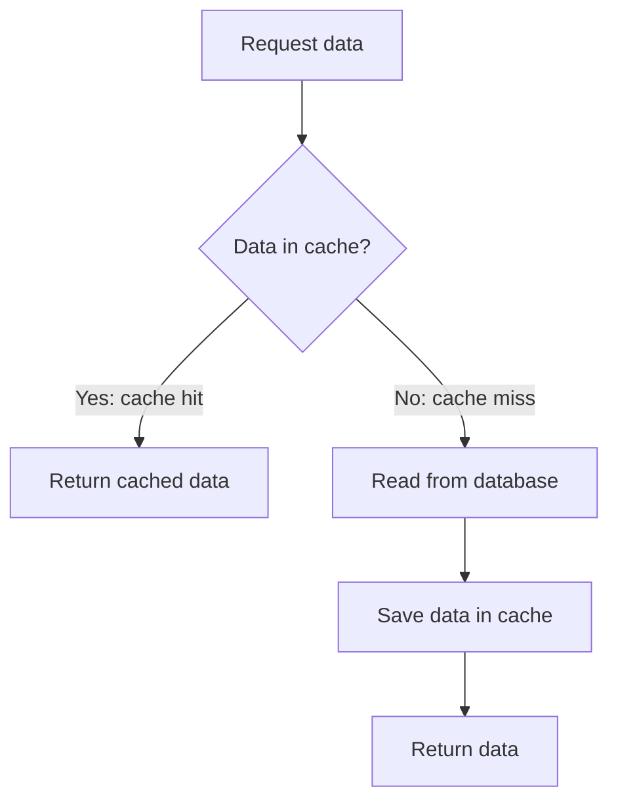

# Cache-Aside Pattern

## What is the Cache-Aside Pattern?

Cache-Aside is a way for an application to use a cache to make repeated data requests faster.

The application checks the cache first. If the data is not there, it reads the data from the database and then saves a copy in the cache.

This is also called **lazy loading** because data is added to the cache when it is requested.

## Why do we need it?

Imagine a shopping app where many customers view the same popular product.

Reading the product from the database every time can create extra work. A cache can keep a copy of popular data so later requests can be served faster.

## How does it work?

1. The application checks the cache for the requested data.
2. If the data is found, the application returns it. This is a **cache hit**.
3. If the data is missing, the application reads it from the database. This is a **cache miss**.
4. The application saves the result in the cache and returns it.
5. Later requests may get the data directly from the cache.

## Simple example

A customer opens a product page.

The first time, the product is not in the cache, so the application reads it from the database and stores a copy in the cache.

When another customer opens the same product, the application finds the cached copy and can return it without reading the database again.

## What happens when data changes?

The cache may contain an old copy after the database is updated. The application needs a plan to keep cached data reasonably fresh.

A common approach is to update the database and then remove the old cached entry. The next request gets fresh data from the database and puts the updated value into the cache.

Cache updates need care because failures or concurrent requests can still cause stale data.

## When should we use it?

Cache-Aside is useful when:

- Data is read often.
- The same data is requested repeatedly.
- Reading from the database is relatively expensive.
- Slightly stale data is acceptable for a short period, or the application has a strategy to handle freshness.

It is less useful for data that is rarely requested or changes constantly.

## Benefits and limitations

**Benefits**

- Frequently requested data can be returned faster.
- The cache stores data only when it is requested.
- The database does not need to serve every repeated read.

**Limitations**

- The first request for uncached data still reads from the database.
- Cached data can become stale.
- The application must handle cache misses and cache failures.
- Popular data expiring at the same time can cause many requests to reach the database.

## Common mistakes

- Assuming the cache always has the latest data.
- Forgetting to handle a cache miss.
- Caching every item even when it is rarely requested.
- Choosing a cache lifetime without considering how often the data changes.
- Treating the cache as the permanent source of truth. Usually, the database remains the source of truth.

## Interview questions

**1. What is Cache-Aside?**  
The application checks the cache first and reads from the database only when the data is missing.

**2. What is a cache miss?**  
It means the requested data is not in the cache, so the application must fetch it from another source, usually the database.

**3. Why is Cache-Aside also called lazy loading?**  
Because data is added to the cache only when an application requests it.

**4. What is one disadvantage of Cache-Aside?**  
The cached data can become stale if updates are not handled carefully.

## YouTube video

**Video 1:** [What is Cache Aside Pattern ? | The Caching Strategy Behind Instagram and Netflix's Fast Responses](https://youtube.com/shorts/YGavg_wXra4?si=ut01A9kEjhTp8azx)
**Video 2:** [When to Choose Which Caching Pattern ? — Cache Aside vs Read Through vs Write Through](https://youtube.com/shorts/EaB0u0DKJwU?si=3p1QYB9twbd1cKhS)

## Related concepts

- [Caching](../02-components/caching.md)
- [Redis](../02-components/redis.md)
- [Databases](../01-fundamentals/databases.md)
- [Timeout Pattern](./timeout-pattern.md)
