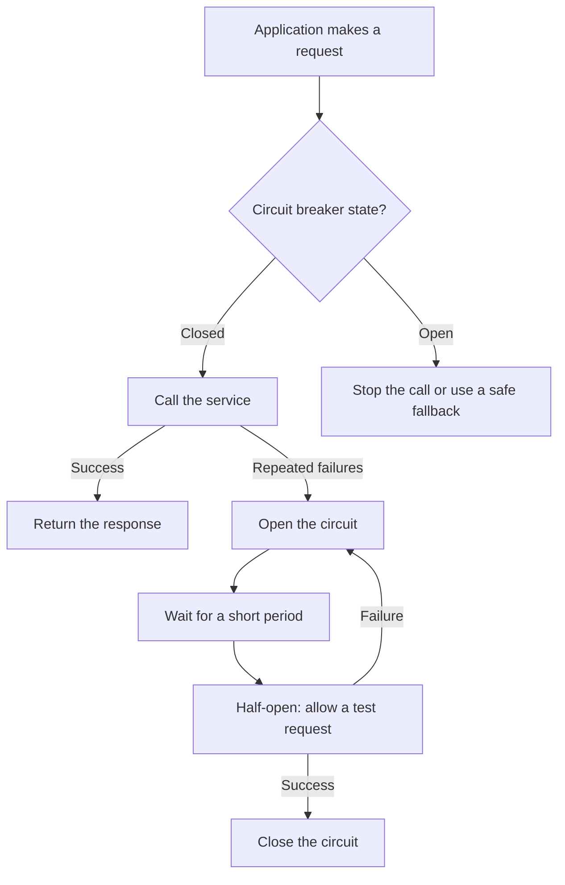

# Circuit Breaker Pattern

## What is the Circuit Breaker Pattern?

The Circuit Breaker Pattern stops an application from repeatedly calling a service that is failing.

It helps prevent one failing service from causing more problems in the rest of the system.

Think of an electrical circuit breaker: when it detects a problem, it cuts the connection to help protect the system.

## Why do we need it?

Imagine a food delivery app calling a payment service. The payment service becomes slow or starts failing.

If the app keeps sending requests, those requests may wait, use up resources, and make the problem worse.

A circuit breaker can temporarily stop calls to that service. The application can return a clear error or use a fallback, if one is safe and available.

## How does it work?

The circuit breaker has three states:

- **Closed:** Requests are allowed through to the service. The breaker watches for failures.
- **Open:** Requests are stopped for a short period. The application does not keep calling the failing service.
- **Half-open:** After waiting, the breaker allows a small number of test requests to check whether the service has recovered.

## Simple example

A food delivery app uses a payment service to process an order.

1. The payment service starts failing.
2. The circuit breaker detects repeated failures and opens.
3. For a short time, the app stops sending new requests to that service.
4. After waiting, it allows a test request.
5. If the test succeeds, normal requests can resume. If it fails, the breaker opens again.

**Important:** A circuit breaker does not fix the failing service. It helps protect the rest of the application while that service is unhealthy.

## When should we use it?

Use a circuit breaker when an application repeatedly calls another service over a network and that service may become slow or unavailable.

It is especially useful in systems with multiple services.

For a small application that calls no unreliable external services, you may not need one.

## Circuit Breaker vs. Retry

- **Retry:** Tries a failed request again, usually for temporary failures.
- **Circuit breaker:** Stops calls when failures continue, giving the service time to recover.

They can work together. Use limited retries, timeouts, and a circuit breaker carefully. Too many retries can add extra load to an already struggling service.

## Common mistakes

- Retrying every failed request without a limit.
- Keeping the circuit open forever without checking for recovery.
- Assuming the circuit breaker repairs the service.
- Using a fallback that could cause an unsafe result, such as pretending a payment succeeded.

## Interview questions

**1. What problem does a circuit breaker solve?**  
It stops repeated calls to an unhealthy service and helps prevent failures from spreading.

**2. What are its three states?**  
Closed, open, and half-open.

**3. Is a circuit breaker the same as retry?**  
No. Retry tries again; a circuit breaker temporarily blocks calls after repeated failures.

**4. Does an open circuit mean the service is permanently down?**  
No. It means calls are temporarily blocked. The breaker can test the service again after a waiting period.

## YouTube video

**Video:** [Circuit Breaker Pattern Explained ⚡ | Stop System Failures From Spreading 😳 | System Design EP15](https://youtube.com/shorts/k0dffVpZ9Ys?si=E7rtQnNDRnE2J1ds)

## Related concepts

- [Timeout Pattern](./timeout-pattern.md)
- [Retry Pattern](./retry-pattern.md)
- [Idempotency](./idempotency.md)
- [Event-Driven Architecture](./event-driven-architecture.md)
