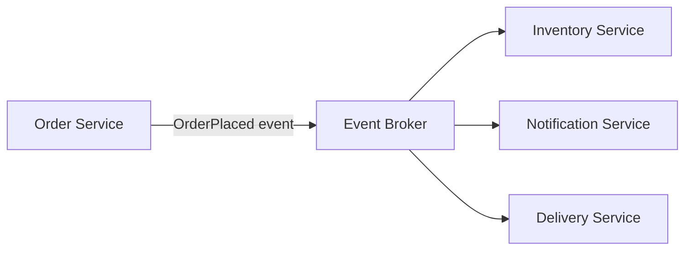

# Event-Driven Architecture

## What is Event-Driven Architecture?

Event-Driven Architecture is a way for parts of an application to communicate by sending and reacting to **events**.

An event is a message that says something has happened, such as `OrderPlaced` or `PaymentCompleted`.

## Why do we need it?

Imagine a customer places an order. The system may need to update inventory, send a confirmation message, and notify the delivery team.

If the order service calls every service directly, it becomes tightly connected to them. With event-driven architecture, it can publish an event and let interested services react to it.

## How does it work?

- **Producer:** The part of the application that creates an event.
- **Event broker:** A system that carries or distributes events to interested services. A message broker is often used for this.
- **Consumer:** A service that receives an event and performs a task.

## Simple example

A customer places an order.

1. The Order Service saves the order.
2. It publishes an `OrderPlaced` event.
3. The event broker delivers the event to interested services.
4. The Inventory Service updates stock.
5. The Notification Service sends an order confirmation.
6. The Delivery Service can begin its next step when appropriate.

The Order Service does not need to call each of these services directly. New consumers can be added later without changing the order service's direct flow.

## When should we use it?

It is useful when one action needs to trigger several independent tasks, especially when those tasks can happen in the background.

Examples include order updates, sending emails, inventory updates, and activity notifications.

For a small application with only a few simple actions, direct function calls may be easier. Event-driven systems also add complexity: events can be delayed, delivered more than once, or processed in a different order.

## Event-Driven Architecture vs. direct calls

- **Direct calls:** One service asks another service to do something and may wait for its response.
- **Event-driven communication:** A service announces that something happened, and interested consumers react to that event.

Event-driven communication is often asynchronous, but the terms are not exactly the same. A system can use events in different ways.

## Common mistakes

- Treating an event as a command. `OrderPlaced` describes something that happened; `CreateOrder` asks for an action.
- Assuming an event is processed instantly.
- Assuming each event is delivered exactly once.
- Ignoring duplicate events, failures, and monitoring.
- Using a broker when a simple direct call would be enough.

## Interview questions

**1. What is an event?**  
An event is a record that something has happened, such as an order being placed.

**2. What are a producer and a consumer?**  
A producer publishes an event. A consumer receives the event and reacts to it.

**3. Why use an event broker?**  
It helps deliver events to interested consumers and reduces the need for services to call each other directly.

**4. What is one disadvantage?**  
Processing may be delayed, and the system needs to handle duplicate events and failures.

## YouTube video

**Video:** [Event Driven Architecture Explained in 60 Seconds | System Design | Day 35](https://youtube.com/shorts/dS7fPUo4Aww?si=ug4mdKzjonHgoBq2)

## Related concepts

- [Message Queues](../02-components/message-queues.md)
- [Synchronous vs. Asynchronous](../03-architecture/sync-vs-async.md)
- [Microservices](../03-architecture/monolith-vs-microservices.md)
- [Idempotency](./idempotency.md)
