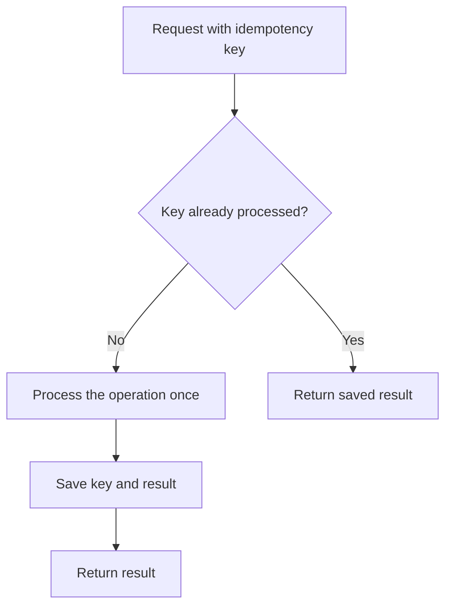

# Idempotency

## What is Idempotency?

Idempotency means that repeating the same request does not repeat its effect.

For example, if a customer clicks **Pay** twice because the page is slow, the system should not charge them twice for the same payment.

## Why do we need it?

Requests can be sent more than once. A customer may click a button again, a browser may resend a request, or a client may retry after a timeout.

Without protection, the same action could create duplicate orders or payments.

## How does it work?

A common approach is to use an **idempotency key**: a unique value created for one operation.

1. The client sends the request with an idempotency key.
2. The server checks whether it has already processed that key.
3. If the key is new, the server processes the request and stores the result with the key.
4. If the same key arrives again, the server returns the saved result instead of performing the operation again.

## Simple example

A customer pays ₹500 for an order.

The payment request includes the key `pay-order-123`.

The payment succeeds, but the response is delayed. The customer tries again using the **same key**.

The server sees that the key was already processed and returns the previous result. It does not charge the customer again for that operation.

**Important:** Retrying with the same key is essential. A new key may be treated as a new operation.

## When should we use it?

Idempotency is useful for operations where repeating an action could cause a problem, such as:

- Payments
- Creating orders
- Booking tickets
- Processing refunds

It is less important for operations that can safely be repeated, such as reading a list of products.

## Idempotency vs. Retry

- **Retry** means sending a request again after a failure or timeout.
- **Idempotency** helps make repeating a request safe.

They often work together: retry a request when appropriate, and use an idempotency key for operations that must not happen twice.

## Common mistakes

- Creating a new idempotency key for every retry.
- Checking the key but not storing the operation result reliably.
- Allowing two simultaneous requests with the same key to process the operation twice.
- Assuming idempotency means every request in the application can never create duplicates.

## Interview questions

**1. What problem does idempotency solve?**  
It prevents repeated requests from performing the same operation more than once.

**2. Why is it important for payments?**  
A client may retry after a timeout even when the first payment succeeded. Idempotency helps prevent a second charge.

**3. What is an idempotency key?**  
It is a unique identifier used to recognize repeated requests for the same operation.

**4. Is retry the same as idempotency?**  
No. Retry sends a request again; idempotency makes repeated requests safe.

## YouTube video

**Video 1:** [What is Idempotency? Backend Basics Explained](https://youtube.com/shorts/OUSlqK-NlxQ?si=LVXt6gd5-hfbUauu)
**Video 2:** [PATCH = Idempotent? 🤔 Most Devs Get This Wrong!](https://youtube.com/shorts/TPCIGMt1J0Y?si=YynaSHub3nfadVWA)

## Related concepts

- [Timeout Pattern](./timeout-pattern.md)
- [Retry Pattern](./retry-pattern.md)
- [Circuit Breaker](./circuit-breaker.md)
- [Event-Driven Architecture](./event-driven-architecture.md)
