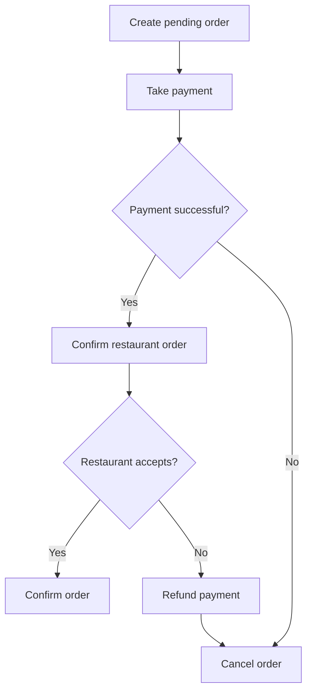

# Saga Pattern

## What is the Saga Pattern?

The Saga Pattern helps manage one business operation that involves several microservices.

Instead of using one large database transaction across all services, the system breaks the operation into smaller steps. Each service completes its own step.

If a step fails, the system may run **compensating actions** to undo the earlier steps where possible.

## Why do we need it?

Imagine a food delivery order that involves the Order, Payment, and Restaurant services.

The order may be created successfully, but payment could fail. The system must handle this carefully so the customer is not left with an unfinished order.

The Saga Pattern defines what should happen at each step, including what to do if a later step fails.

## How does it work?

1. The Order Service creates a pending order.
2. The Payment Service attempts to take payment.
3. The Restaurant Service confirms the order.
4. If every step succeeds, the order can be marked as confirmed.
5. If a step fails, the system runs suitable compensating actions, such as cancelling the pending order or refunding a payment.

## Simple example

A customer orders food for ₹500.

The Order Service creates a pending order, and the Payment Service charges the customer. Then the restaurant rejects the order.

The system may refund the payment and cancel the order. The refund and cancellation are compensating actions.

**Important:** A compensating action does not always erase the past. For example, a refund is a new transaction that returns money; it does not make the original charge never have happened.

## When should we use it?

Use the Saga Pattern when one business operation spans multiple services, and each service manages its own data.

Common examples include food delivery, travel booking, and online shopping.

For a simple application using one database transaction, a Saga is usually unnecessary.

## Two ways to coordinate a Saga

- **Choreography:** Services react to events, and each service knows which event to publish next.
- **Orchestration:** A coordinator tells each service which step to perform and manages the overall flow.

You only need to understand this basic difference at first.

## Common mistakes

- Assuming a Saga gives the same rollback as one database transaction.
- Forgetting to define what happens when a step fails.
- Assuming a refund or cancellation always succeeds immediately.
- Ignoring retries, duplicate messages, and monitoring.
- Using a Saga for a process that could be handled by one simple database transaction.

## Interview questions

**1. What problem does the Saga Pattern solve?**  
It helps coordinate a business operation across multiple services without relying on one shared database transaction.

**2. What is a compensating action?**  
It is a follow-up action that counteracts an earlier step, such as refunding a payment or cancelling a reservation.

**3. What is the difference between choreography and orchestration?**  
In choreography, services react to events. In orchestration, a coordinator directs the steps.

**4. When is a Saga useful?**  
When one business operation involves multiple services, and failures must be handled across those services.

## YouTube video

**Video:** [SAGA pattern #systemdesign #microservicesarchitecture #distributedcomputing](https://youtube.com/shorts/EOoa18HQgY0?si=TTuK6gy8AgGSrAVA)

## Related concepts

- [Event-Driven Architecture](./event-driven-architecture.md)
- [Idempotency](./idempotency.md)
- [Retry Pattern](./retry-pattern.md)
- [Microservices](../03-architecture/monolith-vs-microservices.md)
- [Message Queues](../02-components/message-queues.md)
