# Designing LinkedIn Job Search

> Designing LinkedIn's job search system, covering API gateways, load balancing, scalability, API design, database selection, caching, Elasticsearch, and event-driven architecture.

## 1. Objective

Understand how to approach a system design interview by moving from unstructured requirements to a complete system design.

## 2. Requirements

### Functional Requirements

* Job seekers should be able to search for jobs by text and location.
* Job seekers should be able to view a job and similar jobs.
* Job seekers should be able to apply for a job.
* Optional: Employers should be able to post and update jobs.

**Out of Scope:** Feed ingestion, job alerts, employer dashboard, billing, notifications, messaging, profile, and authentication.

### Non-Functional Requirements

* **Users:** 10 million daily users.
* **Peak Traffic:** Weekdays between 7 PM and 10 PM, with traffic increasing by 6 times during peak hours.
* **User Location:** Users are distributed across different regions of India.
* **Availability vs. Consistency:** Availability is the priority for job search.
* **Search Freshness:** Newly posted jobs can take up to 2 minutes to appear in search results.

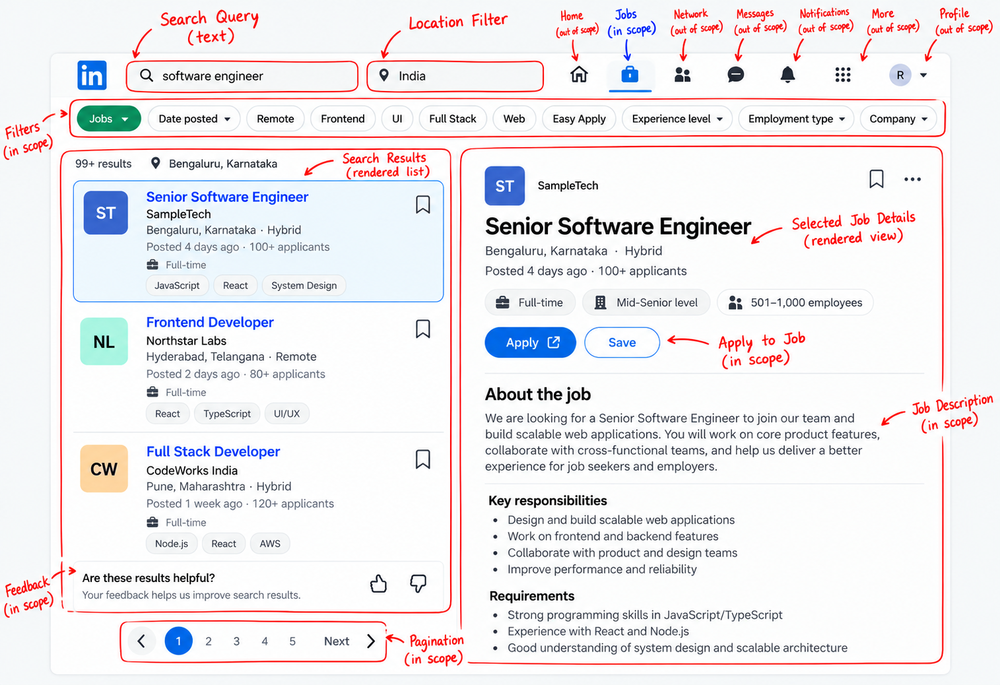

## 3. Back-of-the-Envelope Estimates

> Estimate daily job search activity and convert it into requests per second to understand the system's expected load.

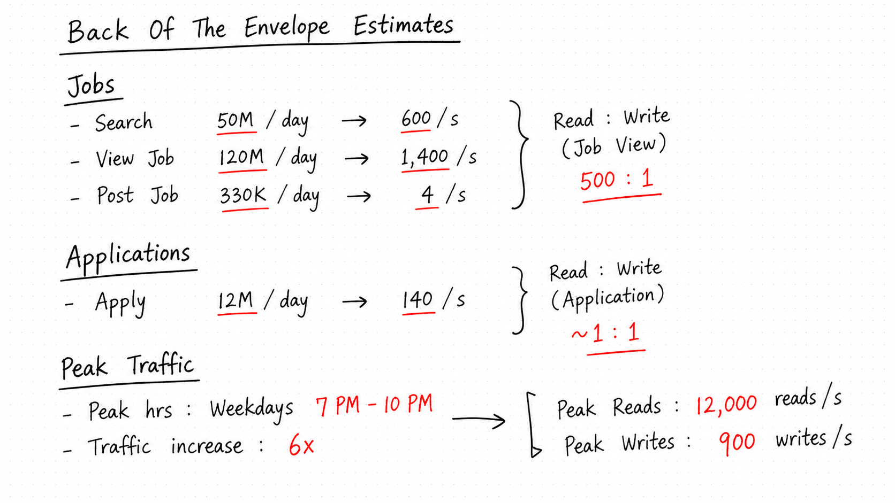

So, Job search is a read-heavy system, with significantly more reads than writes.

## 4. Data Modeling

> Understand how job-related data is structured, how entities relate to each other, and how to avoid data redundancy while maintaining referential integrity.

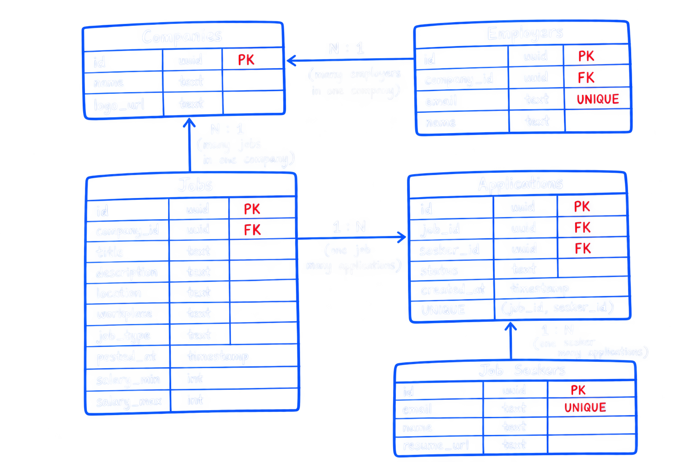

## 5. API Design

> Design simple REST APIs using HTTP methods, query parameters, pagination, and appropriate status codes for searching jobs, viewing job details, managing job postings, and applying for jobs.

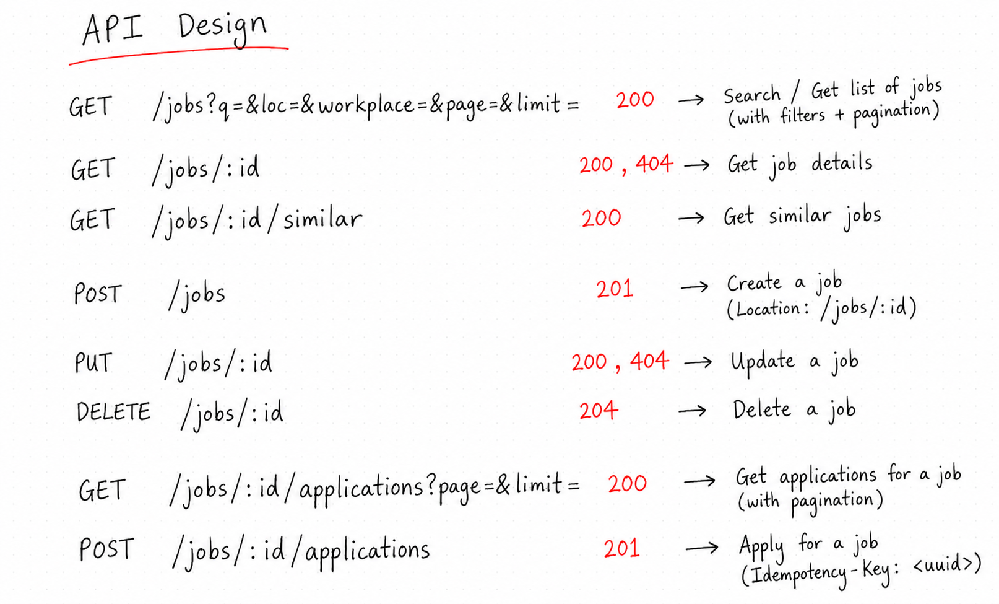

## 6. High-Level Design
> Start with a simple architecture for LinkedIn Job Search.

### Architecture Diagram


### How It Works

1. Users search for jobs through their browser.
2. The server processes requests and communicates with PostgreSQL to retrieve job data.
3. Amazon SES sends emails when users apply for jobs.
4. Blob Storage stores company logos, images, and resumes.

### Trade-offs

This design is simple to build and easy to manage. PostgreSQL stores job data, while separate services handle emails and file storage. However, as more users join, the server and database may struggle to handle all the requests. We can improve this later as we scale the system.

## 7. Sequence Diagram

> Shows how a job search request travels from the client to the server and database.

### Sequence Diagram

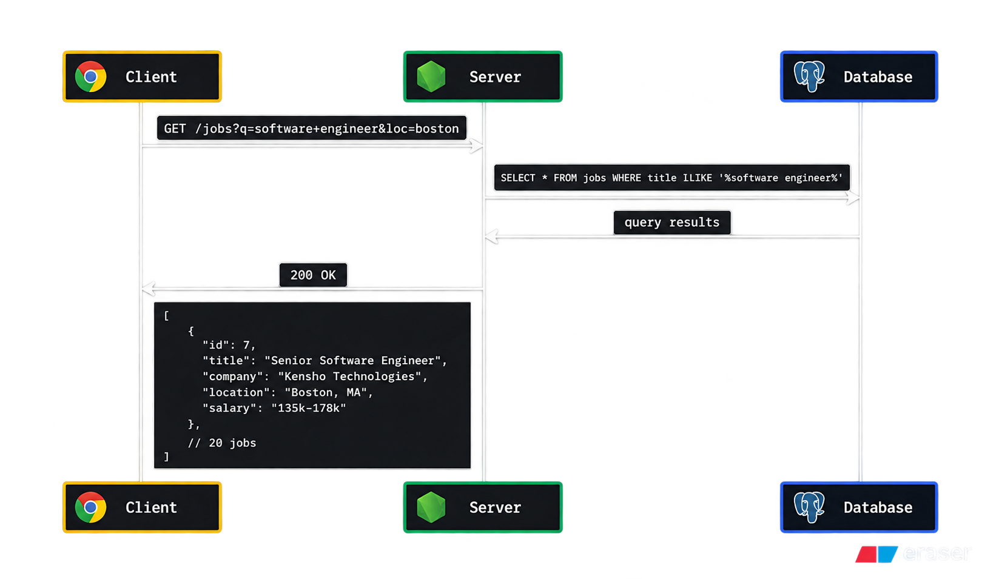

### How It Works

1. The client sends a `GET /jobs?q=software+engineer&page=1&limit=10` request to the server.
2. The server queries PostgreSQL to find jobs matching the search term.
3. PostgreSQL returns the matching jobs using offset pagination.
4. The server returns a `200 OK` response with the job listings in JSON format.

## 8. Scaling the Server

> Distribute incoming requests across multiple server instances to handle peak traffic.

## 8. Scaling the Server

> Handle peak traffic by distributing requests across multiple independent server instances.

### Architecture Diagram


### Load Balancer Stateless Servers


### How It Works

1. During peak hours, the system handles around 12,000 read requests per second.
2. The load balancer distributes requests across multiple server instances instead of relying on one large server.
3. Each server processes requests and communicates with the shared PostgreSQL database.
4. Servers remain stateless, so requests from the same user can go to different instances.
5. Any data needed between requests is stored outside individual servers, allowing instances to be added or removed easily.

### Trade-offs

This approach makes it easier to handle traffic spikes and scale the application by adding more servers. However, it adds a load balancer to manage, and the shared database can still become a bottleneck as traffic grows.

## 10. Database Bottleneck and Indexing

> Improve job search performance as the database grows.

### Architecture Diagram

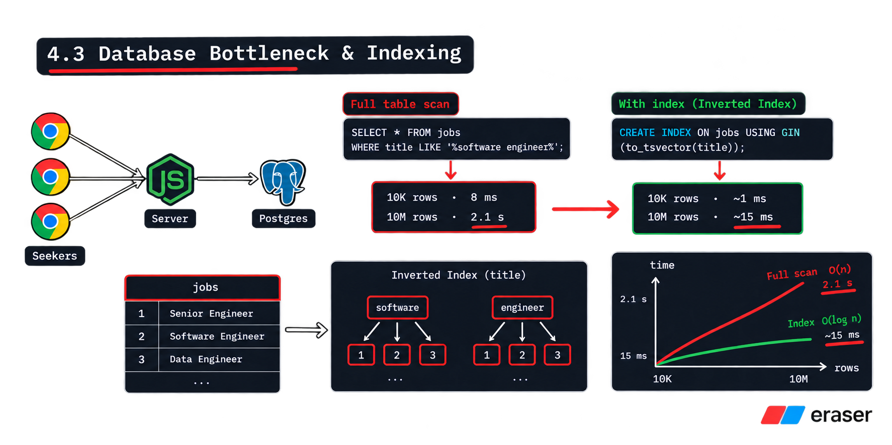

### How It Works

1. As job postings increase, searching millions of records becomes slower.
2. Without an index, PostgreSQL scans records to find matching job titles. Searching 10 million rows can take around 2.1 seconds.
3. We create a **GIN index** on job titles to speed up full-text searches.
4. With the index, searching 10 million rows can take around 15 milliseconds.

### Trade-offs

Indexing makes job searches faster, but it requires extra disk space and makes writes slightly slower because the index must also be updated.

## 11. Caching Hot Searches with Redis

> Use Redis to reduce database load when many users search for the same jobs.

### Architecture Diagram


### How It Works

1. A user searches for a job, and the server checks Redis for cached results.
2. If the results are not in the cache, the server queries PostgreSQL and stores the results in Redis.
3. When another user makes the same search, the server returns the cached results instead of querying the database again.
4. Each cached search has a **60-second TTL**, after which the cache entry expires.

### Trade-offs

Redis reduces database load and makes repeated searches faster. However, users may see slightly outdated results until the cache expires.

## 12. Latency and Geo-Distributed Replicas

> Make the application faster for users who are far away from the main server.

### Architecture Diagram

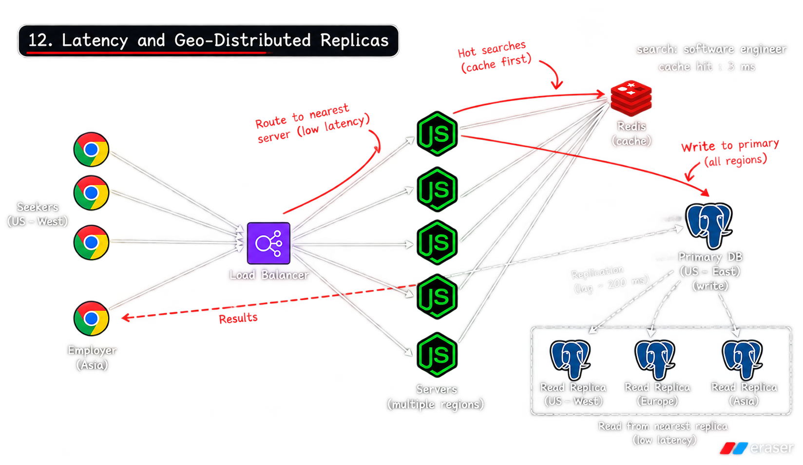

### How It Works

Imagine our main server is in the eastern part of the India, but a user is searching for jobs from the western part. The request has to travel a long distance, so the user may have to wait longer for results.
To solve this, we place servers and read-only database copies in different locations, closer to users.

- Users get job search results from a nearby server and database copy.
- When someone creates or updates a job, the change goes to the main database, called the **primary database**.
- The read-only copies receive these changes from the primary database.

### Trade-offs

Users can get search results faster, but creating or updating a job may take longer because all changes must go to the primary database.

## 13. Replication Lag and Eventual Consistency

> Understand why a database copy may show old data for a short time.

### Architecture Diagram

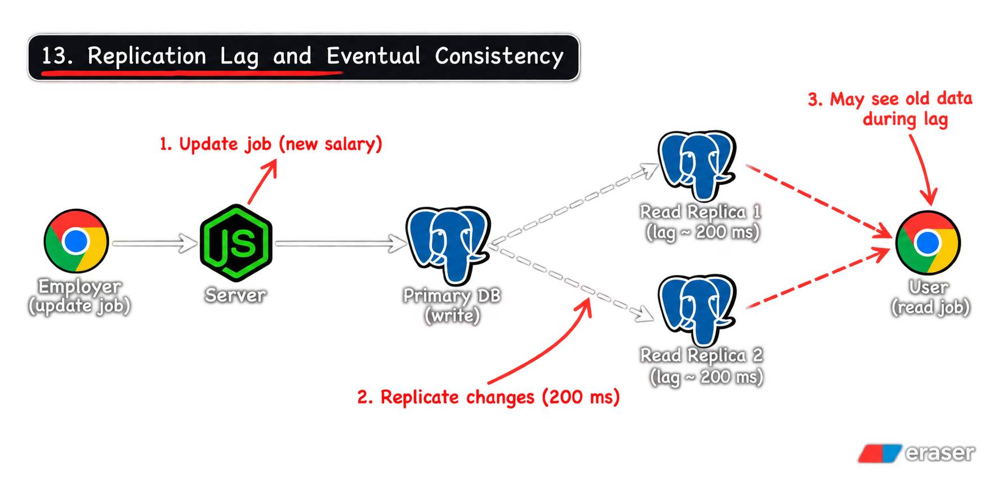

### How It Works

Suppose an employer changes a job's maximum salary from ₹5 lakh to ₹10 lakh.

1. The server saves the new salary in the primary database.
2. The employer receives a success response.
3. The database copies start receiving the updated salary.
4. During this update, a user searching through a database copy might still see the old salary.
5. After a short time, all copies receive the update and show the new salary.

The delay before a database copy receives the latest change is called **replication lag**. In this example, the delay is around 200 milliseconds.
When the copies eventually receive the latest data, this is called **eventual consistency**.

### Trade-offs

For a job search system, showing an old salary for a very short time is usually acceptable. However, systems such as payment applications need to be much more careful about showing old data.

## 14. CDN for Static Assets

> Load company logos and images faster by keeping copies closer to users.

### Architecture Diagram

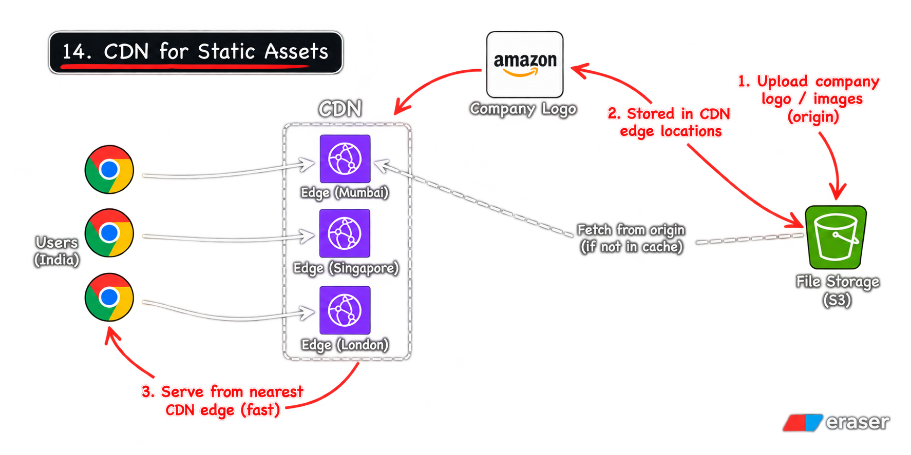

### How It Works

Company logos and images are stored in file storage, such as Amazon S3.
When users open a job page, their browsers need to download these files. If the files are stored far away, loading them can take longer.
A **CDN** solves this by keeping copies of files in different locations around the world.
For example, if a user in India opens a job page, the CDN can send the company logo from a nearby location instead of fetching it from far away.
A CDN can also store copies of static pages and other content that does not change often.

### Trade-offs

A CDN makes images and other static content load faster. However, when a company changes its logo, some users may see the old logo until the updated copy reaches their location.

## 15. Recap: The Scaled System

> See how all the components work together to handle more users and make the application faster.

### Architecture Diagram

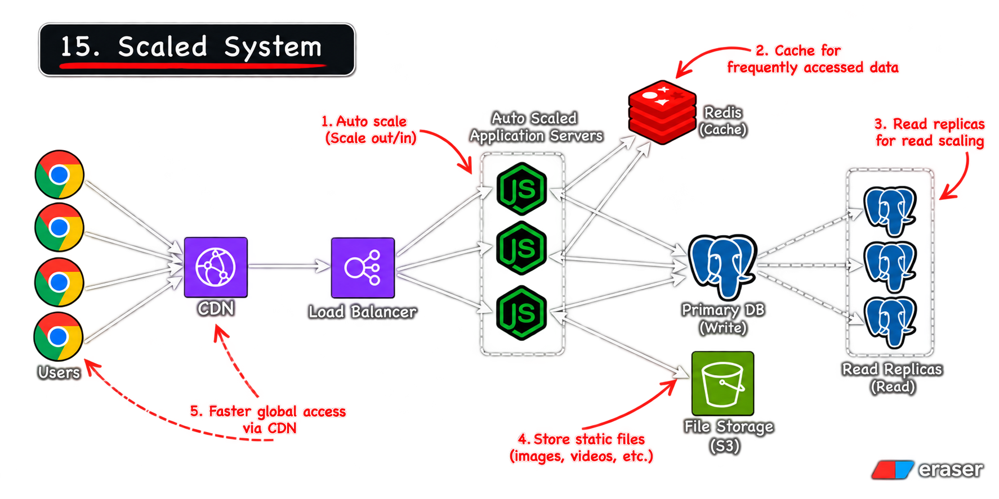

### How It Works

1. Job seekers and employers send requests to the application.
2. The CDN sends images and other static files from a nearby location.
3. The load balancer distributes requests across six server instances.
4. Redis stores frequently searched job results. If the same search happens again, the server can return the saved results without querying the database.
5. If the results are not in Redis, the server gets the data from a database.
6. Read requests can go to read-only database copies, while creating or updating jobs goes to the primary database.
7. Servers and database copies in different locations help users get faster responses.

### Trade-offs

This design can handle more users and reduce waiting time. However, managing servers, caches, and database copies in different locations makes the system harder to maintain.

## 16. Deep Dive: Microservices

> Split one large backend into smaller services, each responsible for a specific task.

### Architecture Diagram

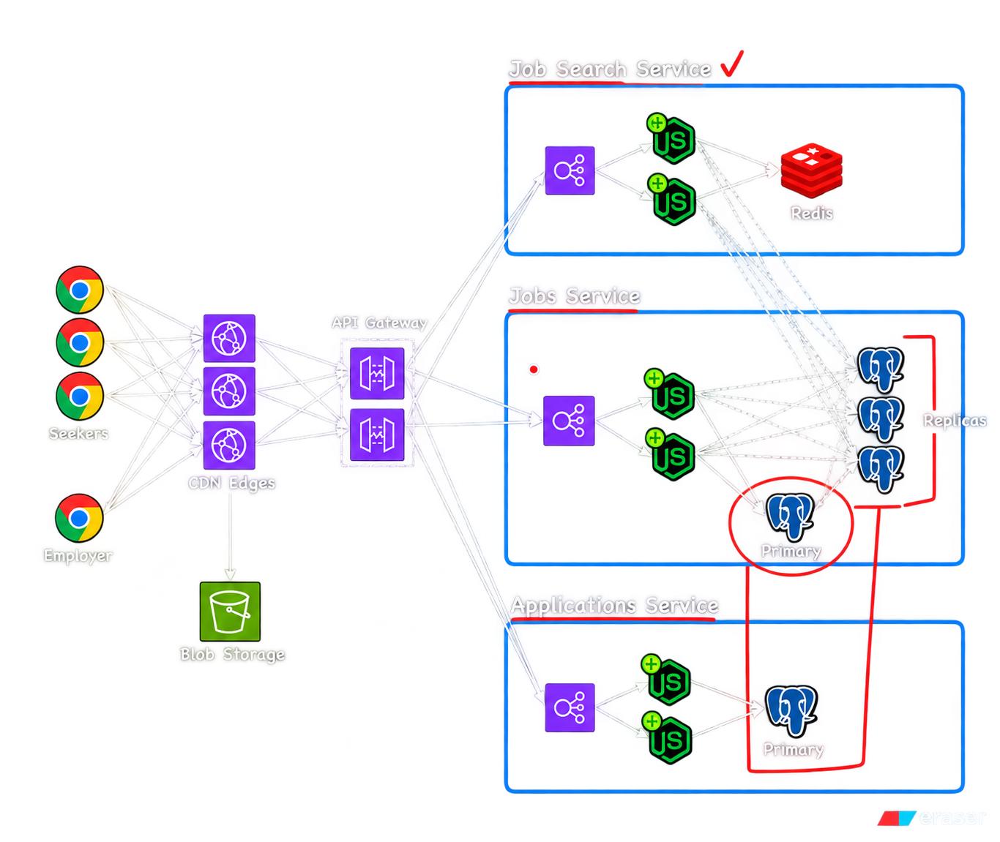

### How It Works

In the beginning, we can build the backend as one application called a **monolith**. As the number of users grows, some features may receive much more traffic than others.
For example, job search may receive many more requests than job applications. Instead of scaling the entire backend for every search request, we can split it into three services:

- **Job Search Service:** Finds jobs for users. It uses Redis and read-only database copies to handle search requests.
- **Job Service:** Creates and updates job postings. It saves changes to the primary database.
- **Application Service:** Handles users applying for jobs.

Each service can run on multiple server instances. We can add more instances to the service that needs to handle more traffic.
At first, these services can share the same primary database. This makes the first version easier to build, but each service should have clear responsibility for its data.

### Trade-offs

Microservices let us scale each part separately. However, we now have more services to build, deploy, and manage instead of one application.

## 17. API Gateway

> Use one entry point to send requests to the correct backend service.

### Architecture Diagram

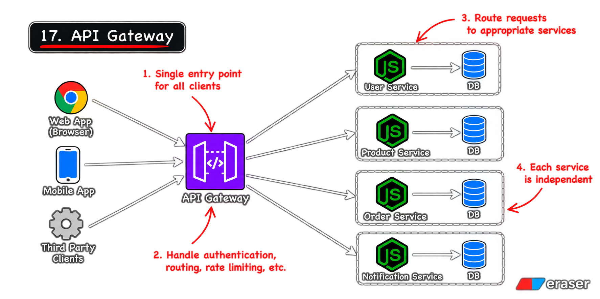

### How It Works

Our system now has separate services for searching jobs, managing jobs, and handling applications.
Without an API Gateway, the client may need to know which service handles each request.
The **API Gateway** makes this simpler:

1. The client sends a request to the API Gateway.
2. The gateway checks the request URL.
3. It sends the request to the correct service.
4. The service processes the request and returns the response.

We run at least two gateway instances so that if one stops working, the other can continue handling requests.

### Trade-offs

The API Gateway gives clients one place to send requests and keeps service details hidden from them. However, it adds another component that we need to run and manage.

## 18. Event-Driven Architecture with Kafka

> Let services share updates through events instead of waiting for each other to finish their work.

### Architecture Diagram

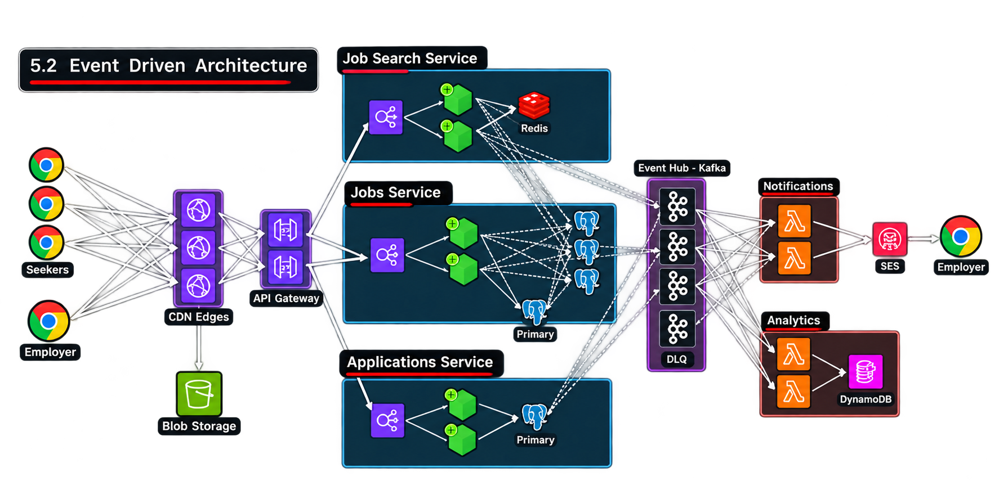

### How It Works

Suppose an employer updates a job posting. After saving the change, the system may need to update search results, send notifications, and record information for analytics.
Without an event-based approach, the job service may need to contact each of these services directly.
With **Kafka**, the process works like this:

1. The job service saves the job update.
2. It sends an event to Kafka saying that the job has changed.
3. Other services listen for this event and do their own work.
4. The notification service can send a notification, while the search indexer updates the search data.

The job service does not need to wait for all these tasks to finish before responding to the employer.
Kafka also keeps events while a consumer service is temporarily unavailable, so that service can process them when it becomes available again.

### Trade-offs

Kafka allows services to work independently and helps the system handle busy periods. However, it adds more parts to manage, and some tasks finish later instead of immediately.

## 19. Search with Elasticsearch

> Use Elasticsearch to find jobs faster and return more relevant search results.

### Architecture Diagram

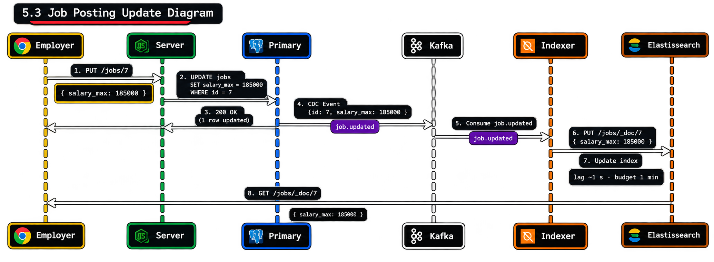

### How It Works

PostgreSQL stores the main job data, but searching a large number of jobs with complex search rules can become slow.
We can use **Elasticsearch** to handle job searches.
For example, when a user searches for "ReactJS developer", we want to find relevant jobs, not just jobs that contain an exact match for the words.
The process works like this:

1. An employer creates or updates a job.
2. The Job Service saves the change in PostgreSQL.
3. An event is sent to Kafka.
4. An indexer receives the event and updates Elasticsearch.
5. When a user searches for a job, the Job Search Service queries Elasticsearch and returns matching results.

PostgreSQL remains the main place where job data is stored. Elasticsearch keeps a searchable copy of that data.

### Trade-offs

Elasticsearch can make job searches faster and help return more relevant results. However, updates do not reach Elasticsearch immediately, so users may briefly see old search results.

## 20. Backend for Frontend

> Give web and mobile applications a backend that returns the data each one needs.

### Architecture Diagram

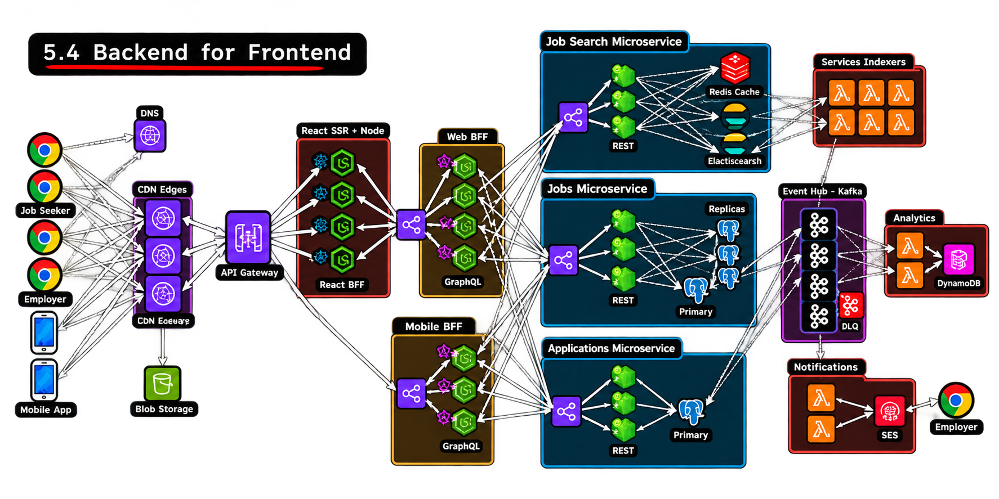

### How It Works

Our system has several backend services. A web page or mobile app may need data from more than one service to show a single screen.
For example, a job details page may need job information, company details, and application status.
Without a separate layer, the frontend may need to call several services and combine their responses itself.
A **Backend for Frontend**, or BFF, solves this problem.

- The **Web BFF** collects the data needed by the website.
- The **Mobile BFF** collects the data needed by the mobile app.
- Each BFF gets data from the required backend services and returns it to the client.

We can also use **GraphQL** at this layer. It allows the frontend to ask for the specific fields it needs instead of receiving unnecessary data.

### Trade-offs

A BFF makes frontend code simpler and reduces unnecessary requests and data. However, we need to build and maintain an additional backend layer for each client type.
## 21. Reliability and Failure Handling

> Keep the job search system working even when some parts fail.

### How It Works

In a real system, servers can stop working, databases can become unavailable, and network problems can interrupt requests. We need to handle these problems without bringing down the whole application.

1. **Server failure:** If one server stops working, the load balancer sends new requests to the other available servers.
2. **Database failure:** If the primary database becomes unavailable, a standby database can take over if failover is configured.
3. **Cache failure:** If Redis is unavailable, the system can get search results directly from the database. This keeps search working, but it may increase database traffic.
4. **Service failure:** If a service is temporarily unavailable, the system can retry the request a limited number of times.
5. **Kafka failure:** Events can remain in Kafka while a consumer service is unavailable and be processed when it recovers, as long as the events are retained.
6. **Monitoring:** We monitor errors, response times, and server health to find problems quickly.

### Trade-offs

These methods help the system recover from failures and keep job search available. However, they add more work and infrastructure to manage. Retries can also increase traffic, so they should be limited.
