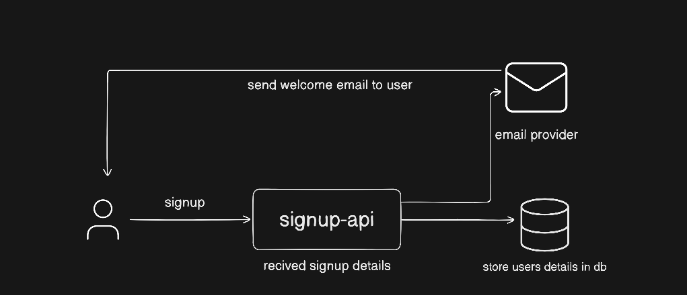
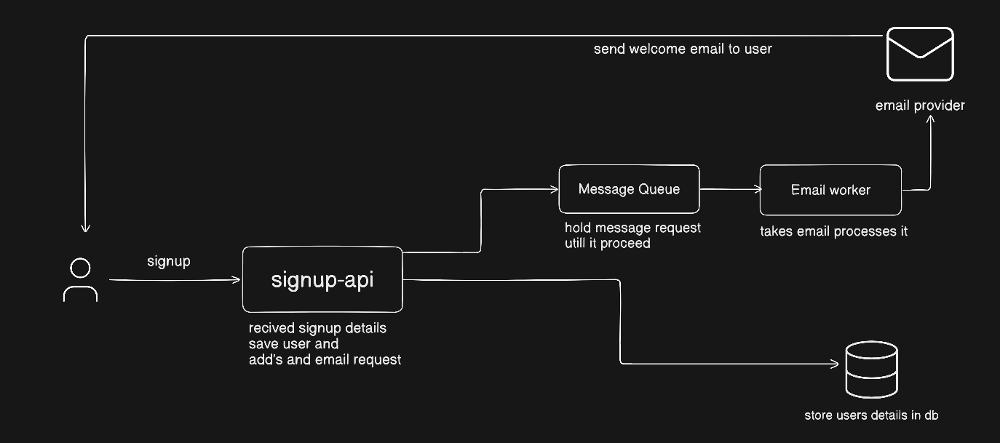
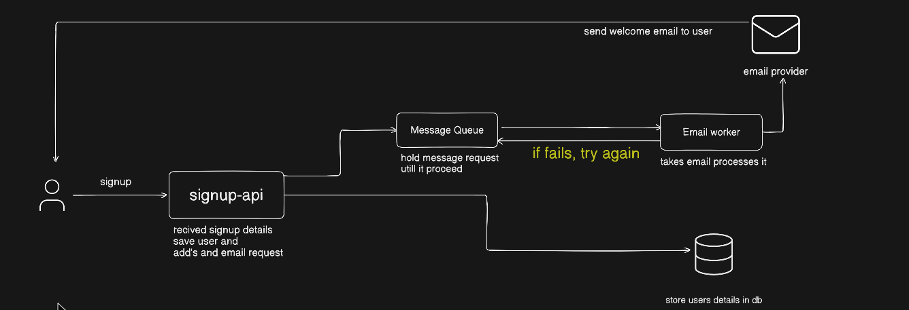
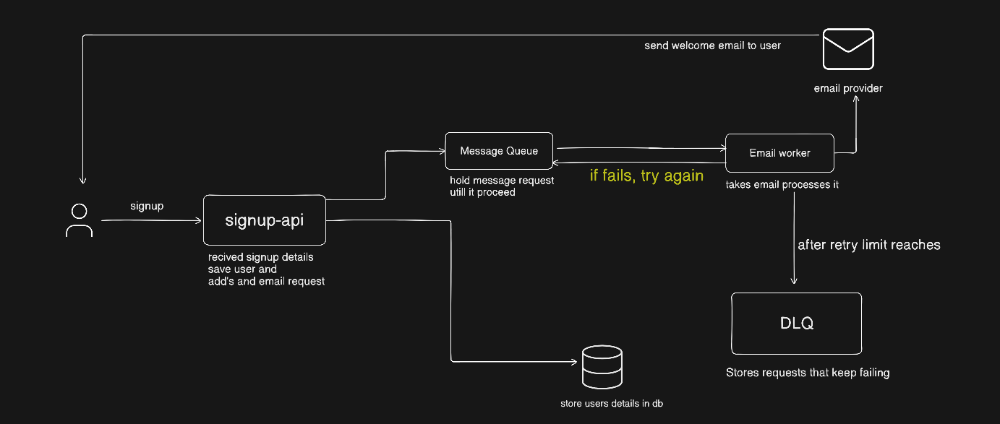
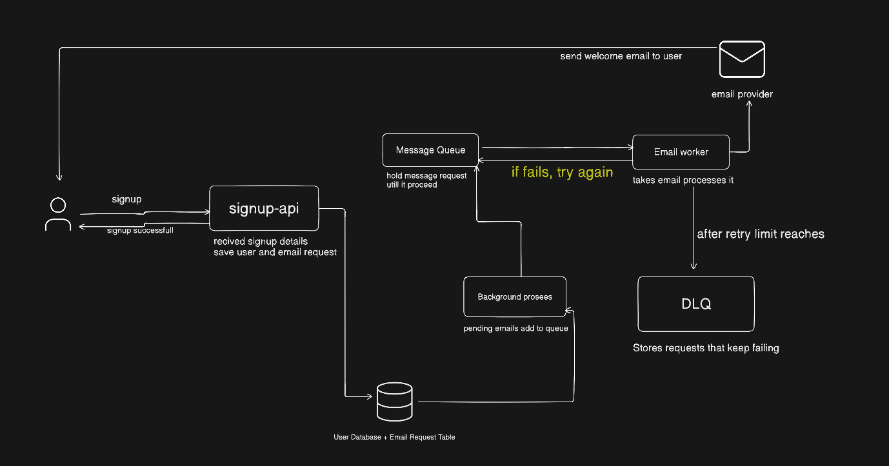

# System Design for Notification Service

## 1. Interview question

**Interviewer:** “Design a notification service for a social media application. When a new user signs up, the application should send them a welcome email. Please walk me through your approach step by step.”

## 2. Requirements

### Functional requirements

1. Send a welcome email after signup.
2. Try sending the email again if it fails.
3. Support more notification types later.

### Non-functional requirements

1. Signup should not wait for the email.
2. Email requests should not be lost if sending fails.

## 3. First design: basic signup flow

### What I can say

“I'll start with the basic signup flow. The user sends their details to the Signup API, and the API saves the new account in the database.”

### Basic architecture

### How it works

1. The user sends signup details to the Signup API.
2. The Signup API saves the user's details in the database.
3. The Signup API contacts the Email Provider to send a welcome email.
4. The Email Provider sends the email to the user.

### Problem with this design

The Signup API directly contacts the Email Provider. If the provider is slow or unavailable, signup may also be delayed or fail. But our requirement says signup should not wait for the email.

## 4. Add a Message Queue and Email Worker

### What I can say

“To solve this problem, I'll add a Message Queue and an Email Worker. The Signup API will add an email request to the queue. The Email Worker will process the request and contact the Email Provider separately. Signup will not need to wait for the email to be sent.”

### Updated architecture

### How it works

1. The user sends signup details to the Signup API.
2. The Signup API saves the user details in the database and adds an email request to the Message Queue.
3. The Message Queue holds the request until it is processed.
4. The Email Worker takes the request and sends the email through the Email Provider.
5. The Email Provider sends the email to the user.

## 5. Retry if email sending fails

### What I can say

“If the Email Provider is temporarily unavailable, the worker should not lose the request. It should try sending the email again after some time.”

### Retry flow

**Main idea:** If sending fails, keep the request and try again later.

## 6. Add a Dead Letter Queue (DLQ)

### What I can say

“If an email fails repeatedly, I don't want the worker to retry forever. I'll set a maximum number of retry attempts. If all attempts fail, the request will be moved to a separate queue so we can investigate it later.”

### Architecture with a DLQ

The **Dead Letter Queue (DLQ)** stores requests that keep failing after the retry limit is reached.

## 7. Keep email requests in the database

### Problem

The user may be saved in the database, but adding the email request to the Message Queue may fail. In that case, the email request could be lost.

### What I can say

“To prevent this, I'll save the email request in the database along with the user account. A background process will check for pending email requests and add them to the Message Queue when it is available.”

### Final architecture

### How this part works

1. The Signup API saves the user and the email request in the database.
2. The API returns a signup success response to the user.
3. The Background Process checks for pending email requests.
4. The Background Process adds pending requests to the Message Queue.

The user does not need to wait for the welcome email. The email request is saved so it can be added to the queue later if the queue is unavailable.

## 8. Explain the final design

1. The user signs up.
2. The Signup API saves the user and email request in the database.
3. The API returns a success response.
4. The Background Process adds the email request to the Message Queue.
5. The Message Queue holds the request until it is processed.
6. The Email Worker takes the request and sends the email through the Email Provider.
7. If sending fails, the worker retries. If repeated attempts fail, the request moves to the DLQ.

This is how the design sends welcome emails without making the user wait for email delivery and handles failed email requests.
