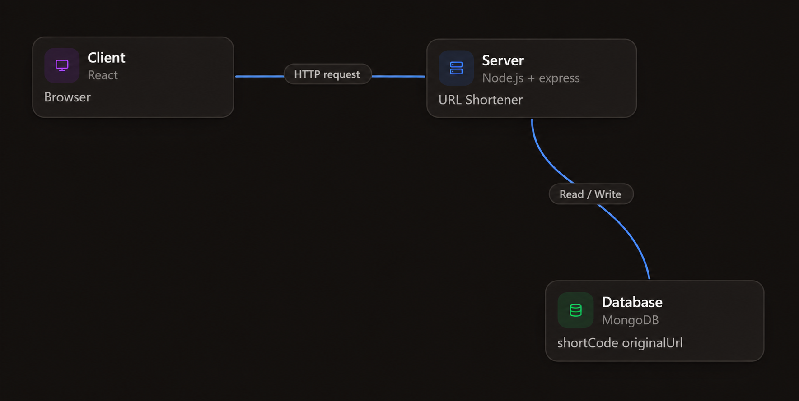
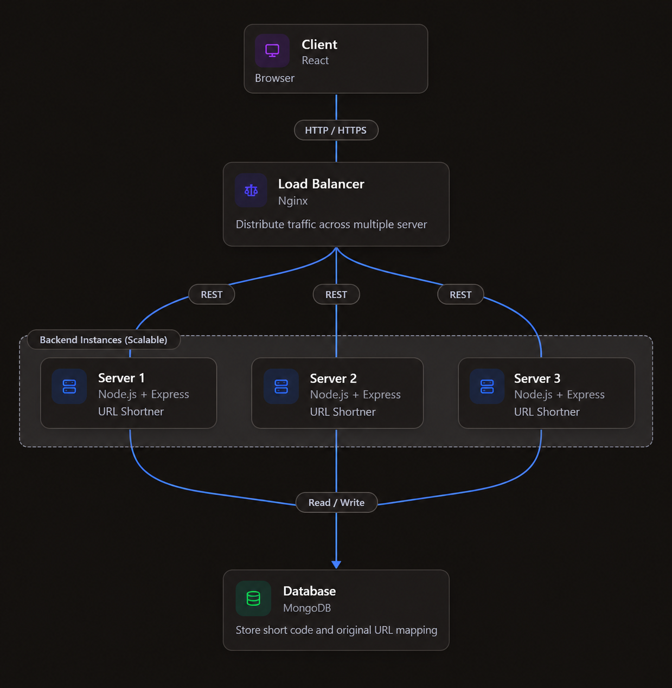
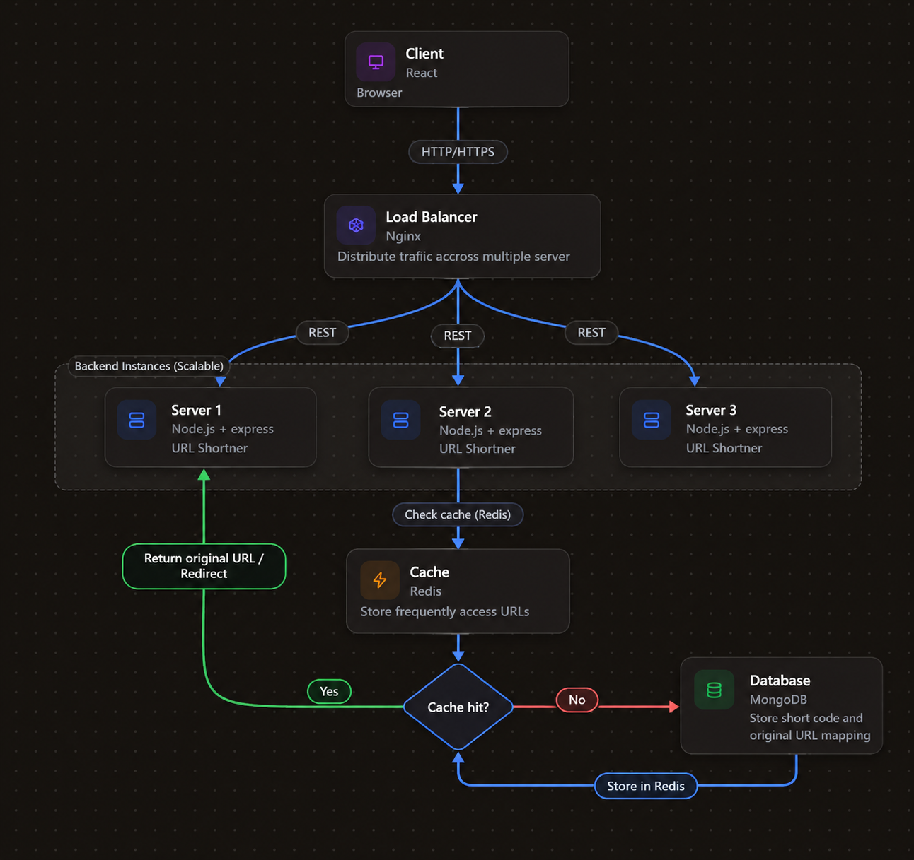

# URL Shortener

A URL Shortener creates a short link for a long URL. When someone opens the short link, the application sends them to the original URL.

**Interview approach:** Start with the basic design. Add more components only when the interviewer asks how you would handle more traffic or improve performance.

## 1. Interview question

**Interviewer:** “Design a URL Shortener like Bitly. Users should be able to submit a long URL, receive a short URL, and be redirected to the original URL when they open the short link. Explain your design and how you would improve it as traffic grows.”

## 2. Requirements

### Functional requirements

- A user can submit a long URL and receive a short URL.
- Opening the short URL redirects the user to the original URL.

### Basic non-functional requirements

- Redirects should be fast.
- Each short code must point to the correct original URL.
- The URL mapping must be stored reliably.

## 3. First answer: design the basic system

### What you can say

“I would start with one backend server and one database. The client sends the long URL to a Node.js and Express backend. The backend creates a unique short code and stores it with the original URL in MongoDB. When someone opens the short link, the backend finds the original URL in MongoDB and redirects the user to it.”

### Basic architecture



### Main components

- **Client / Browser:** Submits a long URL or opens a short link.
- **Backend (Node.js + Express):** Creates short links and handles redirects.
- **MongoDB:** Stores each `shortCode` with its `originalUrl`.

### How it works

**When creating a short URL:**

1. The client sends the long URL to the backend.
2. The backend creates a unique short code.
3. The backend saves the short code and original URL in MongoDB.
4. The backend returns the short URL to the client.

**When opening a short URL:**

1. The browser sends the short code to the backend.
2. The backend looks up the code in MongoDB.
3. The backend redirects the browser to the original URL.

Start with this design. Do not add the load balancer or Redis to your first answer.

## 4. Follow-up question: scale the application

**Interviewer:** “Suppose the application becomes popular and receives a large number of requests. How would you scale it?”

### What you can say

“First, I would check the traffic and find the bottleneck. If one backend server cannot handle the requests, I would run multiple instances of the same backend and place a load balancer in front of them. The load balancer distributes incoming requests across the available servers. All backend instances use the same MongoDB database, so they can access the same URL mappings.”

### Architecture with a load balancer



### What changes?

- **Load balancer:** Distributes requests across backend instances.
- **Multiple backend instances:** Run the same Node.js application at the same time.
- **Shared MongoDB:** Keeps URL mappings available to every backend instance.

This is horizontal scaling: running more instances of the same application. Millions of users alone do not tell us exactly how many servers we need. We need to check request volume and performance.

## 5. Follow-up question: improve redirect speed

**Interviewer:** “Users frequently open the same short links, and database reads are increasing. How would you make redirects faster?”

### What you can say

“I would add Redis as a cache for frequently accessed URL mappings. The backend checks Redis first. If the mapping is found, it uses the cached value. If it is missing, the backend reads it from MongoDB and saves a copy in Redis for future requests. MongoDB remains the permanent source of the URL mappings.”

### Architecture with Redis



### Cache hit and cache miss

- **Cache hit:** Redis contains the mapping, so the backend can use it without querying MongoDB.
- **Cache miss:** Redis does not contain the mapping, so the backend reads it from MongoDB and stores a copy in Redis.

Redis is an improvement, not a requirement for the first version. If Redis is unavailable, the backend can read from MongoDB as long as the database is available.

## 6. Five more interview follow-up questions

These questions help you practise how to change the design when a new requirement appears. You do not need to add every component at the start.

### Question 1: “How will you make sure two URLs do not receive the same short code?”

**Answer:** “I would generate the short code from a unique ID, for example by using Base62 encoding. I would also create a unique index on `shortCode` in MongoDB to prevent duplicate mappings.”

Base62 uses numbers, uppercase letters, and lowercase letters. It is an encoding method, not encryption.

### Question 2: “What should happen if someone opens a short code that does not exist?”

**Answer:** “The backend checks MongoDB if the mapping is not in the cache. If the short code does not exist, I would return `404 Not Found` instead of redirecting the user.”

### Question 3: “What if Redis becomes unavailable?”

**Answer:** “The backend can temporarily read URL mappings directly from MongoDB. Redirects may become slower and MongoDB may receive more traffic, but the application can continue to work if MongoDB is available.”

### Question 4: “How would you prevent one user from creating too many short URLs?”

**Answer:** “I would add rate limiting to limit how many creation requests a user or IP address can send in a given period. This helps reduce abuse and unnecessary load.”

### Question 5: “The business wants click analytics, but redirects must remain fast. How would you design it?”

**Answer:** “I would send a click event to a message queue and let a background worker process analytics separately. This keeps analytics work out of the main redirect path. I would add a queue only if analytics is a requirement.”

## 7. Simple API design

| Method | Endpoint | Purpose |
|---|---|---|
| `POST` | `/api/shorten` | Create a short URL |
| `GET` | `/:shortCode` | Look up the URL and redirect |

## 8. Example database record

```json
{
  "shortCode": "abc123",
  "originalUrl": "https://example.com/products/mobile"
}
```

The database should ensure that `shortCode` is unique.

## 9. How to practise this in an interview

1. Read the main question and draw the basic design from memory.
2. Explain the create and redirect flows.
3. Add the load balancer only when asked about higher traffic.
4. Add Redis only when asked about faster redirects or frequent database reads.
5. Practise the five follow-up questions and explain why each change is useful.

**Remember:** A strong interview answer does not start with every possible component. It starts with a simple working design and grows as the interviewer introduces new needs.

## Diagram files

- [Basic architecture](./diagrams/01-basic-architecture.png)
- [Load-balanced architecture](./diagrams/02-load-balanced-architecture.png)
- [Cache hit/miss flow](./diagrams/03-cache-hit-miss-flow.png)
